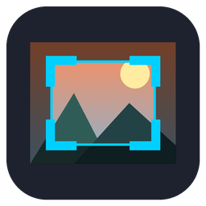
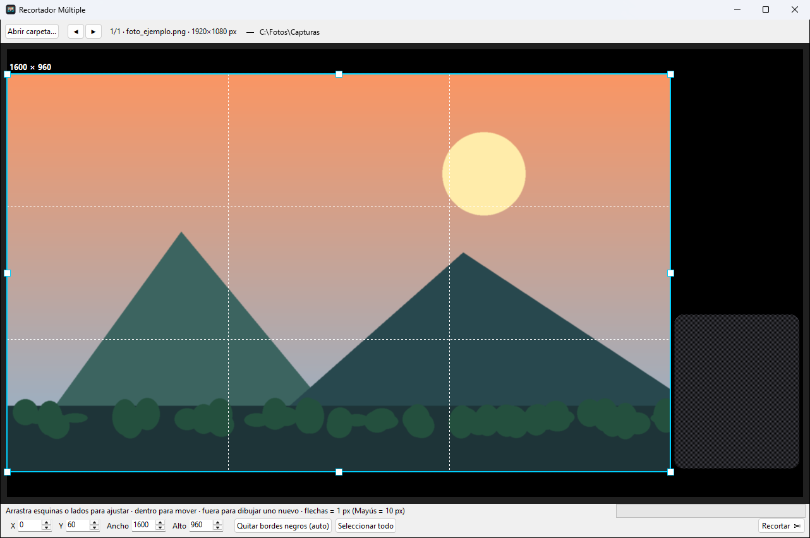

<p align="center">
  
</p>

<h1 align="center">Recortador Múltiple</h1>

<p align="center">
  Recorta <b>una</b> imagen a mano y aplica el mismo recorte a <b>todas</b> las de la carpeta.
</p>

<p align="center">
  <a href="https://github.com/Dreex14/recortador-multiple/releases/latest"><b>⬇ Descargar para Windows</b></a>
  &nbsp;·&nbsp;
  <a href="#-english">🇬🇧 Read in English</a>
</p>

<p align="center">
  
</p>

## ¿Para qué sirve?

Para quitar los mismos bordes a muchas imágenes de una vez. Por ejemplo, las franjas negras de las capturas de un emulador o las barras de una grabación de pantalla.

1. Abres una carpeta.
2. Ajustas el recorte sobre una imagen con el ratón (esquinas, lados o moviendo el recuadro) o escribiendo los píxeles exactos.
3. Pulsas **Recortar ✂** y eliges si aplicarlo al resto de la carpeta.

Los recortes se guardan en la subcarpeta `recortadas`. **Las imágenes originales no se modifican nunca.**

> [!NOTE]
> **Idioma:** el programa se abre en español si la distribución del teclado de Windows es española (de España o latinoamericana), y en inglés en cualquier otro caso. En inglés, la carpeta de salida se llama `cropped`.

## Funciones

- **Asas en esquinas y lados** para ajustar el recorte, y arrastre del recuadro entero para moverlo.
- **Lupa ampliada** mientras arrastras, para ajustar al píxel.
- **Campos numéricos** (X, Y, Ancho, Alto) para valores exactos.
- **Teclado**: las flechas mueven el recorte 1 px (10 px con Mayús).
- **Quitar bordes negros (auto)**: detecta las franjas negras e ignora elementos pequeños superpuestos.
- **Navegación ◀ ▶** para elegir qué imagen usar como referencia. El recorte se mantiene al cambiar de imagen.
- **Interfaz en español e inglés**, elegida automáticamente según el teclado.
- **Procesado por lotes en segundo plano**, con barra de progreso y resumen final.
- Solo recorta las imágenes **del mismo tamaño** que la de referencia; las demás se saltan y aparecen en el resumen.
- Formatos: PNG, JPG/JPEG, BMP, WEBP y TIFF. Los JPG se guardan con calidad 95.

## Cómo usarlo

### Opción 1: ejecutable para Windows (sin instalar nada)

1. Descarga `RecortadorMultiple.exe` desde [**Releases**](https://github.com/Dreex14/recortador-multiple/releases/latest).
2. Haz doble clic y elige la carpeta con tus imágenes.
   También puedes **arrastrar la carpeta encima de `RecortadorMultiple.exe`** para abrirla directamente.

> [!NOTE]
> El ejecutable no está firmado, así que Windows SmartScreen puede mostrar «Windows protegió su PC». Pulsa **Más información → Ejecutar de todas formas**. Algunos antivirus también marcan por error los programas empaquetados con PyInstaller. Si prefieres no fiarte del `.exe`, usa la opción 2.

### Opción 2: desde el código fuente (Windows, macOS, Linux)

Necesitas [Python 3.9 o superior](https://www.python.org/downloads/) con Tkinter, que viene incluido en el instalador oficial de Windows y macOS. En Linux puede hacer falta instalar `python3-tk`.

```bash
git clone https://github.com/Dreex14/recortador-multiple.git
cd recortador-multiple
pip install -r requirements.txt
python recortar.pyw
```

También puedes pasarle la carpeta directamente:

```bash
python recortar.pyw "C:/ruta/a/mis/fotos"
```

En Windows, hacer doble clic en `recortar.pyw` abre el programa sin ventana de consola.

## Atajos y controles

| Acción | Cómo |
|---|---|
| Cambiar tamaño | Arrastra una esquina o un lado del recuadro |
| Mover el recorte | Arrastra desde dentro del recuadro |
| Dibujar un recorte nuevo | Arrastra fuera del recuadro |
| Mover 1 px / 10 px | Flechas / Mayús + flechas |
| Valor exacto | Escribe en X, Y, Ancho o Alto y pulsa Intro |
| Quitar bordes negros | Botón **Quitar bordes negros (auto)** |
| Seleccionar toda la imagen | Botón **Seleccionar todo** |
| Imagen anterior / siguiente | Botones **◀ ▶** |
| Recortar | Botón **Recortar ✂** |

> [!TIP]
> En escenas muy oscuras la detección automática puede recortar de más. Usa como referencia una imagen con mucha luz o ajusta el recuadro a mano.

## Compilar el ejecutable

En Windows, con Python instalado:

```bash
build.bat
```

Esto instala las dependencias y genera `dist/RecortadorMultiple.exe` con PyInstaller. Si cambias el icono, puedes volver a generarlo con `python assets/generar_icono.py`.

## Estructura

```
recortar.pyw            Programa (editor + recorte por lotes)
assets/icono.ico        Icono del programa y de la ventana
assets/icono.png        Icono para este README
assets/generar_icono.py Script que dibuja el icono
docs/captura.png        Captura para este README
build.bat               Compila dist/RecortadorMultiple.exe
requirements.txt        Dependencias para ejecutar
requirements-dev.txt    Dependencias para compilar
```

## Licencia

El código de este proyecto se publica bajo la [licencia MIT](LICENSE). © 2026 Dreex.

### Dependencias y sus licencias

| Proyecto | Uso | Licencia |
|---|---|---|
| [Python](https://www.python.org/) | Lenguaje e intérprete incluido en el `.exe` | [PSF License](https://docs.python.org/3/license.html) |
| [Tkinter / Tcl/Tk](https://www.tcl.tk/) | Interfaz gráfica | [Licencia BSD de Tcl/Tk](https://www.tcl.tk/software/tcltk/license.html) |
| [Pillow](https://python-pillow.github.io/) | Abrir, recortar y guardar imágenes | [MIT-CMU (HPND)](https://github.com/python-pillow/Pillow/blob/main/LICENSE) |
| [PyInstaller](https://pyinstaller.org/) | Empaquetar el `.exe` (solo para compilar) | [GPL 2.0 con excepción para el bootloader](https://github.com/pyinstaller/pyinstaller/blob/develop/COPYING.txt), que permite distribuir el ejecutable con cualquier licencia |

### Exención de responsabilidad

Este programa se ofrece «tal cual», sin garantías. El autor no se hace responsable del uso que se haga del programa ni de las imágenes que se procesen con él. Asegúrate de tener derecho a usar y modificar las imágenes con las que trabajes.

---

## 🇬🇧 English

<details>
<summary><b>Read the README in English</b></summary>

<br>

**Crop <b>one</b> image by hand and apply the same crop to <b>every</b> image in the folder.**

### What is it for?

It removes the same borders from many images at once, such as the black bars in emulator screenshots or the edges of a screen recording.

1. Open a folder.
2. Adjust the crop on one image with the mouse (corners, edges or by moving the box) or by typing exact pixel values.
3. Click **Crop ✂** and choose whether to apply it to the rest of the folder.

The cropped images are saved in a `cropped` subfolder. **Your original images are never modified.**

> [!NOTE]
> **Language:** the program opens in Spanish if your Windows keyboard layout is Spanish (Spain or Latin America), and in English otherwise. With Spanish, the output folder is called `recortadas`.

### Features

- **Corner and edge handles** to resize the crop, and drag the whole box to move it.
- **Magnifier** while dragging, for pixel-perfect adjustments.
- **Number fields** (X, Y, Width, Height) for exact values.
- **Keyboard**: arrow keys move the crop 1 px (10 px with Shift).
- **Remove black borders (auto)**: detects black bars and ignores small overlaid elements.
- **◀ ▶ navigation** to pick which image to use as the reference. The crop is kept when you switch images.
- **Spanish and English interface**, chosen automatically from your keyboard layout.
- **Background batch processing**, with a progress bar and a summary at the end.
- Only images **the same size** as the reference are cropped; the others are skipped and listed in the summary.
- Formats: PNG, JPG/JPEG, BMP, WEBP and TIFF. JPGs are saved at quality 95.

### How to use it

#### Option 1: Windows executable (nothing to install)

1. Download `RecortadorMultiple.exe` from [**Releases**](https://github.com/Dreex14/recortador-multiple/releases/latest).
2. Double-click it and choose the folder with your images.
   You can also **drag the folder onto `RecortadorMultiple.exe`** to open it directly.

> [!NOTE]
> The executable is not signed, so Windows SmartScreen may show "Windows protected your PC". Click **More info → Run anyway**. Some antivirus programs also flag PyInstaller-packaged programs by mistake. If you'd rather not trust the `.exe`, use option 2.

#### Option 2: from source (Windows, macOS, Linux)

You need [Python 3.9 or newer](https://www.python.org/downloads/) with Tkinter, which is included in the official Windows and macOS installers. On Linux you may need to install `python3-tk`.

```bash
git clone https://github.com/Dreex14/recortador-multiple.git
cd recortador-multiple
pip install -r requirements.txt
python recortar.pyw
```

You can also pass the folder directly:

```bash
python recortar.pyw "C:/path/to/my/photos"
```

On Windows, double-clicking `recortar.pyw` opens the program without a console window.

### Controls

| Action | How |
|---|---|
| Resize | Drag a corner or an edge of the box |
| Move the crop | Drag from inside the box |
| Draw a new crop | Drag outside the box |
| Move 1 px / 10 px | Arrow keys / Shift + arrow keys |
| Exact value | Type in X, Y, Width or Height and press Enter |
| Remove black borders | **Remove black borders (auto)** button |
| Select the whole image | **Select all** button |
| Previous / next image | **◀ ▶** buttons |
| Crop | **Crop ✂** button |

> [!TIP]
> In very dark scenes the automatic detection may crop too much. Use a bright image as the reference or adjust the box by hand.

### Building the executable

On Windows, with Python installed:

```bash
build.bat
```

This installs the dependencies and builds `dist/RecortadorMultiple.exe` with PyInstaller. If you change the icon, regenerate it with `python assets/generar_icono.py`.

### License

This project's code is released under the [MIT License](LICENSE). © 2026 Dreex.

It uses [Python](https://www.python.org/) ([PSF License](https://docs.python.org/3/license.html)), [Tkinter / Tcl/Tk](https://www.tcl.tk/) ([Tcl/Tk BSD-style license](https://www.tcl.tk/software/tcltk/license.html)) and [Pillow](https://python-pillow.github.io/) ([MIT-CMU](https://github.com/python-pillow/Pillow/blob/main/LICENSE)). The `.exe` is built with [PyInstaller](https://pyinstaller.org/) ([GPL 2.0 with a bootloader exception](https://github.com/pyinstaller/pyinstaller/blob/develop/COPYING.txt), which allows distributing the executable under any license).

### Disclaimer

This program is provided "as is", without warranty of any kind. The author is not responsible for how the program is used or for the images processed with it. Make sure you have the right to use and modify the images you work with.

</details>

---

<p align="center">Hecho por <b>Dreex</b> · Made by <b>Dreex</b></p>
